# Expert Load Imbalance on Ascend NPUs: What We Found

All results to 2026-10-08, in one place. Written to be read without knowing the
codebase. The per-experiment detail lives in [imbalance-findings.md](imbalance-findings.md),
[regime-findings.md](regime-findings.md), [router-bias-findings.md](router-bias-findings.md),
[drift-findings.md](drift-findings.md) and [detection-findings.md](detection-findings.md);
this document is the whole story and supersedes them as a summary.

---

## 1. The question, in plain terms

A Mixture-of-Experts (MoE) language model does not run every part of itself for
every word. Each layer holds many small sub-networks called **experts**, and a
small component called the **router** picks a few of them per token. That is what
makes these models cheap to run: a model with 64 experts might use 6 of them per
token.

To serve such a model you spread the experts across several accelerator chips.
With 64 experts and 4 chips, each chip holds 16. This is **expert parallelism**,
and the chips are called **ranks**.

The problem this project set out to measure: **the router does not spread work
evenly.** Some experts get picked far more often than others. If the popular
experts happen to sit on the same chip, that chip has more work to do, and
every other chip waits for it at the end of each layer. The slow chip is called
a **straggler**.

The received wisdom is that this costs real serving latency, and that it should
be fixed by moving experts between chips to even the load — which is what
vLLM's built-in **EPLB** (Expert Parallel Load Balancer) does.

**The question: how much does expert imbalance actually cost, and can we detect
the cases where it does?**

### The hardware and models

Everything ran on one machine with 8 Ascend 910B3 NPUs — Huawei's accelerators,
roughly comparable to a datacentre GPU — using vLLM Ascend 0.23.0. Two models:

| Model | Experts per layer | Picked per token | Experts per chip (on 4 chips) |
|---|---|---|---|
| DeepSeek-V2-Lite-Chat | 64 | 6 | 16 |
| Mixtral 8x7B | 8 | 2 | 2 |

They were chosen to be as different as possible in expert structure, so that a
result appearing on both is unlikely to be an accident of one model's shape.

### How we measure latency

**TPOT** — time per output token — is the headline number throughout. Once a
model has read your prompt, TPOT is the average time to produce each subsequent
word. It is what makes a chatbot feel fast or slow.

---

## 2. The headline: realistic imbalance costs nothing

**Under every realistic condition we tried, expert imbalance did not change
serving latency at all.** Not a small effect we couldn't resolve — no effect.

The cleanest run spans six different workload imbalance levels on 8 chips with
nothing else running on the machine: TPOT ranges from 130.04 to 130.87 ms, a
0.64% spread with no trend, while the predicted load on the busiest chip rises
from 1.18x to 1.31x of the average.

The same holds on Mixtral, which is the harder test. With 8 experts on 8 chips
each chip holds exactly one expert, so there is no averaging to smooth imbalance
out, and the expert computation is about 70% of the model's arithmetic rather
than 34%. Latency is still flat.

**This is not a failure to create imbalance.** Stragglers do form, and we can see
them in the profiles. The imbalance is real; it just doesn't cost anything.

### Why: two independent reasons, and they compound

**First, concentrating work makes the computation cheaper per unit.** The expert
computation is a matrix multiplication (`GroupedMatmul`). When tokens are spread
thinly, it runs many small multiplications; when they concentrate, it runs fewer,
larger ones, which hardware does far more efficiently. Pushing all traffic onto
6 of 64 experts cut the average call from 112 to 66 microseconds — a 41% saving.

The busiest chip does more work, but each unit of work costs less, and the two
very nearly cancel. **A 20% imbalance in token counts becomes only a ~2.6%
imbalance in actual time.**

> There is a boundary to this. It holds when each expert is handling few enough
> tokens that its cost is dominated by *loading its weights from memory* rather
> than by arithmetic. That is true during word-by-word generation (~48 tokens per
> expert per call). During the initial prompt-reading phase, where an expert sees
> ~384 tokens at once, the arithmetic dominates and concentrating work genuinely
> does make the busy chip slower — 1.6x slower in the extreme case. But the expert
> computation is only 10–16% of that phase's time, so even then the step
> lengthens by just 1.5–4.6%.

**Second, that remaining 2.6% is buried under something much larger.** When the
chips synchronise at the end of each layer, they call a *collective* operation.
We found that **about 95% of the time spent in those collectives is chips waiting
for each other, not transferring data.** And the resulting asymmetry in how long
each chip waits is around 33% — more than ten times anything imbalance produces,
and completely unrelated to it.

So there are two separate reasons imbalance cannot surface: it shrinks by a
factor of six on the way from token counts to time, and what is left is then
swamped.

### A result that inverts the obvious reading

While measuring the waiting, we found something counterintuitive that holds in
**30 out of 30** profiled measurements: **the chip that looks least busy is the
one everyone else is waiting for.**

The reason is that a chip which arrives *early* at a synchronisation point spends
the wait *inside* the collective operation — which the profiler counts as being
busy. The chip that arrives last waits least and therefore looks idle. Anyone
reading an occupancy chart at face value would blame the wrong chip.

Which chip this is changes between otherwise identical runs, and it has nothing
to do with expert load.

### EPLB: retracted 2026-10-12

**This subsection is withdrawn.** The runs behind it never rearranged anything:
recording the placement map (`server.eplb_record_map`) puts vllm-ascend's EPLB in
a record-only mode that plans a placement and never applies it. Its logs show 84
plans and no completed weight transfer. What it measured is the overhead of
collecting load and planning with the layout unchanged. See
[imbalance-findings.md](imbalance-findings.md#eplb-retracted-2026-10-12---it-never-rearranged).
It has now been re-measured with rearrangement actually applied, and the
conclusion survives for different reasons — see
[EPLB, re-measured](#eplb-re-measured-it-rearranges-and-still-buys-nothing)
below. The original text is kept here for the record.

vLLM's load balancer works exactly as designed. Over 84 rearrangement cycles it
cut the token imbalance it measures from 1.139x to 1.007x.

The measured straggler went from 1.026x to 1.027x — unchanged.

**The reason is instructive: EPLB balances token counts, and what costs time is
time.** Token counts overstate the time imbalance by about six times, so EPLB is
carefully removing a 20% skew in a quantity that was already only 2.6% skewed in
the quantity that matters. There is nothing left to win.

Its one measurable effect is overhead: the expert share of compute falls 0.77
percentage points while the absolute expert time is unchanged, meaning EPLB added
work rather than saving any.

**For anyone building monitoring, this is the takeaway: expert token counters are
the wrong signal if you want to predict latency.**

### EPLB, re-measured: it rearranges, and still buys nothing

Re-run on 2026-10-12 with `eplb_record_map` off, so placements are actually
applied: 7–12 completed weight-update cycles per point, EPLB's own busiest-rank
reading driven to ~1.0x from every starting skew, four repeats with the two arms
interleaved in shared rounds.

| skew | EPLB's own reading | TPOT with EPLB off | change with EPLB on |
|---|---|---|---|
| 1.09x (free) | 1.12 → 1.02x | 154.5 ms | −0.47% ±5.45 |
| 1.73x (free) | 1.68 → 1.02x | 152.8 ms | **+4.73% ±4.84** |
| 2.49x | 2.39 → 1.03x | 157.8 ms | +1.42% ±1.99 |
| 3.63x (costs +31%) | 3.49 → 1.09x | 202.1 ms | +1.07% ±2.47 |

**EPLB does its job and the latency does not move.** At 3.63x the skew costs the
unbalanced server +31% TPOT; EPLB removes the imbalance by its own measure and
recovers none of it.

**Rearranging where there is nothing to win costs a few percent at most** — worst
case +4.73% at a 1.73x skew that costs no latency. A single pair there read +10.8%
and dissolved under replication.

One honest limit: at 3.63x, convergence took about 85 s of a 127 s batch, so most
of the measured window is pre-convergence. This cannot show a steady-state gain
even if one exists.

A second limit, found on 2026-10-14 while re-reading the same run: at 3.63x
DeepSeek generates **205 tokens per request instead of 298**. A strong router
bias changes the text the model produces, not only the path it takes to produce
it. TPOT is per token and unaffected, which is why the table quotes it; the
end-to-end and makespan figures at that level fall 16% and 13% for want of work
to do, and must not be read as the skew making the server faster. Within a level
the arms agree on output length to 0.25%, so every EPLB-on-against-off difference
above is unaffected — only comparisons *across* levels are.

**Correction, 2026-10-14: the +31% came from the answers ending early, and at
3.63x there was nothing for EPLB to recover.** The paragraph above was right that
the text changed and wrong that TPOT was immune to it. (Not through the mean
length: holding every request at the shortened *average* costs nothing - see
section 3.) Run
`fixed-length` repeated this experiment with every request forced to generate
exactly 300 tokens (`client.ignore_eos`), at the same measured skew (3.64x). The
cost of skew became **−0.27% ±1.84** (four pairs: −0.1, −2.8, +1.5, +0.4), and
EPLB at that level became a plain false positive: **+3.83% ±1.02**, all four pairs
positive, while it brought its own reading from 3.49x to 1.07x. So the last row of
the table is not "EPLB fails to recover a real cost"; it is "EPLB rearranges where
nothing costs, and pays for it", the same as the 1.73x row. See
[router-bias-findings.md](router-bias-findings.md#fixed-length-output-deepseeks-cost-was-its-early-stops-not-the-skew).

### EPLB on Mixtral: the same null, and the regime that moved under it

DeepSeek is the awkward model to argue from, because below 2.4x it has no cost to
recover. Mixtral was supposed to settle that: at 100 output tokens its cost rises
from the noise floor roughly linearly, +5.83% TPOT at 1.76x and +14.45% at 2.62x,
so there was something sitting there to win. Run `eplb-mixtral` on 2026-10-13: 4
NPUs, three offsets, two arms interleaved in shared rounds, 4 repeats, 24 of 24
points completed. (Every point ran beside another user's jobs on NPUs 4-5,
equally in every arm; first recorded as "no contention", which was wrong.)

| skew | EPLB's own reading | TPOT with EPLB off | change with EPLB on | the screen's gate |
|---|---|---|---|---|
| 1.11x | 1.14 → 1.07x | 154.7 ms | −0.18% ±1.22 | shut (0% of windows) |
| 1.76x | 1.75 → 1.25x | 153.1 ms | +1.85% ±1.88 | open (100%) |
| 2.62x | 2.62 → 1.58x | 159.2 ms | −0.99% ±0.98 | open (100%) |

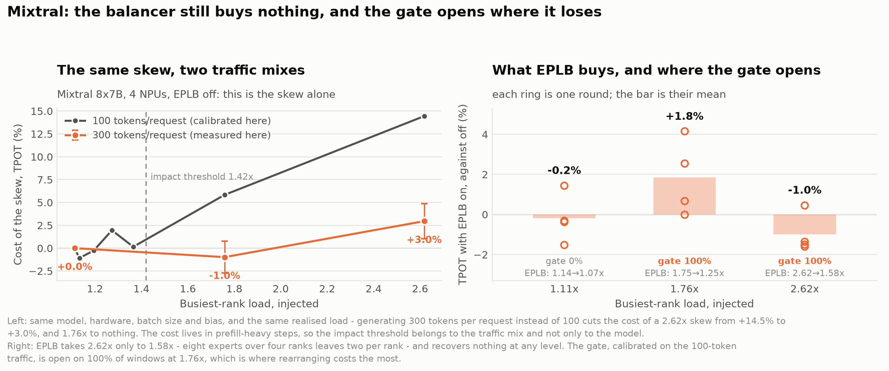

**EPLB buys nothing here either.** Every interval spans zero, in TPOT, end-to-end
latency and makespan alike. Its best reading is −1.9% of makespan at 2.62x where
the skew costs about +6%. The null is therefore not an artefact of DeepSeek's
threshold: it holds on the model that pays for imbalance.

**EPLB cannot balance Mixtral.** It takes 2.62x only to 1.58x, where on
DeepSeek's 64 experts it reaches ~1.0x from any starting skew. Eight experts over
four ranks is two per rank, so moving the hot expert off rank 0 puts it on a rank
that then holds the second-hottest pair. Coarse-grained MoE bounds what *any*
placement can achieve, which is a property of the model rather than of this
implementation, and it bounds the benefit before the implementation gets a turn.

**The cost it was sent to recover was not there.** The off arm at 1.76x is not
slower than at 1.11x (−0.98% TPOT, paired by round), and 2.62x costs +2.95% TPOT,
+5.99% e2e and +5.92% makespan — not +14.45%. Same model, same hardware, same
batch size, same bias target, and the same *measured* load to three decimals. The
difference is the traffic: the calibration generated 100 tokens per request (1.72
prompt tokens for every generated token), this run 300 (0.59). The cost of skew
lives in prefill-heavy steps, which is what the step profiling already said — a
saturated decode step is the same length at every eager offset — and a
decode-dominated workload dilutes it by a factor of five.

The two runs also differ in `gpu_memory_utilization` (0.6 against 0.85), which is
the confound to rule out, and it rules out: the KV cache holds 442k tokens in one
and 911k in the other, which is 1,630 and 1,934 requests of this length, while
`max_num_seqs` is 512 in both. The resident batch is the same 512 either way, so
the extra cache buys nothing that could explain this. Prompt length is identical
too (171 tokens, the same corpus), which leaves generated length as the one thing
that moved.

**So the gate opened exactly where EPLB loses.** Mixtral's impact threshold,
1.42x, was calibrated at 100 tokens. In this run's traffic nothing costs until
well above 2.62x, so the screen's rule opens on 100% of windows at 1.76x, where
EPLB costs +1.85%. Gating comes out worse than leaving EPLB on at every level and
in all three illustrative traffic mixes, by 0.3 to 0.6 percentage points. The
screen is not wrong about the routing: 1.76x is really there. What went stale is
the threshold that converts routing into *this costs something* — and it went
stale on a change in output length, with the model, the hardware and the skew all
held fixed.

DeepSeek shows the same effect, smaller. Its 2.434x threshold also comes from a
100-token sweep, while at 300 tokens 2.49x is free and 3.63x costs +31%, so its
real threshold there is above 2.49x. The two levels the gated run tests, 1.73x and
3.63x, fall either side of both numbers, which is why that run's predictions
survive the correction.
*(Superseded 2026-10-14: with output length held at 300, 3.64x costs nothing on
DeepSeek either, so it has no threshold below 3.64x at 300 tokens, and its 2.43x
rests on a 100-token point whose answers also shortened. The gated run's gate
opening at 3.63x was therefore not opening where EPLB had anything to win.)*

**What this costs the gating argument.** An impact threshold is a per-deployment
calibration, which was already the rule; this makes the output-length mix part of
what "deployment" means, and 30 NPU-minutes is cheap enough that there is no
excuse for carrying one over. But the deeper problem is that the thing being
gated has no measured benefit on either model at any skew either of them was
tested at — seven levels in all, though all of them in the 300-token regime,
which is one of the things still open. The honest policy is then not *gated* but
*never*, and the screen's value is in
deciding whether to deploy a balancer at all rather than in arbitrating each of
its cycles.

### A live gate: it decides correctly, and keeping the placement is not free

Run `eplb-gated` on 2026-10-14 served the gate inside the loop rather than
modelling it: DeepSeek, eplb-fp2's settings, three arms in shared shuffled rounds
(EPLB off, EPLB on, and EPLB applying a plan only when its own worst-layer
reading reaches 2.43x), three levels, 4 repeats, 36 of 36 points completed. Every
point ran beside another user's jobs on NPUs 4-5 (six processes, load average
~30), equally in every arm. ± is the standard deviation of the four paired
differences, as in the tables above.

| skew | EPLB's reading, on / gated | TPOT off | EPLB on | EPLB gated | gate |
|---|---|---|---|---|---|
| 1.09x | 1.12 → 1.02x / 1.12 → 1.12x | 151.4 ms | +1.86% ±9.39 | +0.00% ±4.55 | shut 48 of 48 |
| 1.73x | 1.68 → 1.03x / 1.68 → 1.81x | 151.7 ms | +5.52% ±3.80 | **+3.23% ±0.42** | shut 48 of 48 |
| 3.63x | 3.49 → 1.08x / 3.49 → 1.72x | 199.7 ms | +4.63% ±4.29 | +1.54% ±0.63 | open 8 of 32 |

**The gate does what it was built to do.** It shut on every decision at both free
levels and opened at 3.63x, on all four ranks with identical readings. At 3.63x
it opened twice per point (3.67x, then 3.18x on the worst layer), and shut from
the third decision on, with the worst layer at 1.96-2.28x and the average at
1.72-1.74x. A threshold gate stops rebalancing at the threshold, not at balance,
and here that left the server at half of EPLB's correction and latency no worse
for it.

**The false positive replicated in TPOT.** EPLB-on at 1.73x is +5.52% here, 4 of 4
pairs positive, against eplb-fp2's +4.73%. Pooled over both runs' eight pairs it is
**+5.12%, interval +1.7% to +8.5%** - the first time the cost of rearranging for
nothing excludes zero. `gate-closure`'s +1.52% was end-to-end latency with
streaming off, a different measure in a different client regime; it is not the
same number failing to come back.

**A shut gate still costs most of it.** At 1.73x the gated arm moved nothing, and
cost +3.23% (four pairs between +2.7% and +3.7%, interval +2.6% to +3.9%) - about
60% of what EPLB-on cost. What the gate removes is the transfers; what is left is
EPLB being enabled at all: heat collection, the all-gather of the load, the
planner subprocess, and a loader cycle that walks its state machine moving
nothing. Which of those carries the cost is not established, and the reading is
from one level: at 1.09x the same arm reads +0.00% ±4.55, where the off arm's own
spread is 4.7%, so it neither confirms nor contradicts. Gated against EPLB-on is
−2.1% ±3.1 at 1.73x, not separable from zero.

So the gate is correct and averts at most about 2 points of a 5-point false
positive. The remaining ~3% is the price of turning EPLB on, which no condition
inside `do_update` can avert. That strengthens the conclusion above: the decision
worth making is whether to enable a balancer, and on this evidence the answer is
no.

---

## 3. But strong imbalance *does* cost latency

The null above is about *realistic* imbalance. To find where a cost appears, we
needed to push imbalance far past what normal traffic produces, in a controlled
way.

### The instrument

We add a fixed offset to the router's scores for one chip's experts, just before
it picks. That makes those experts win more often, by an amount we dial up and
down, while the routing still depends on the input and **every expert stays in
use**. (An earlier approach that edited the model's weights instead collapsed
routing onto 6 of 64 experts, which changes two things at once and so cannot
isolate the skew.)

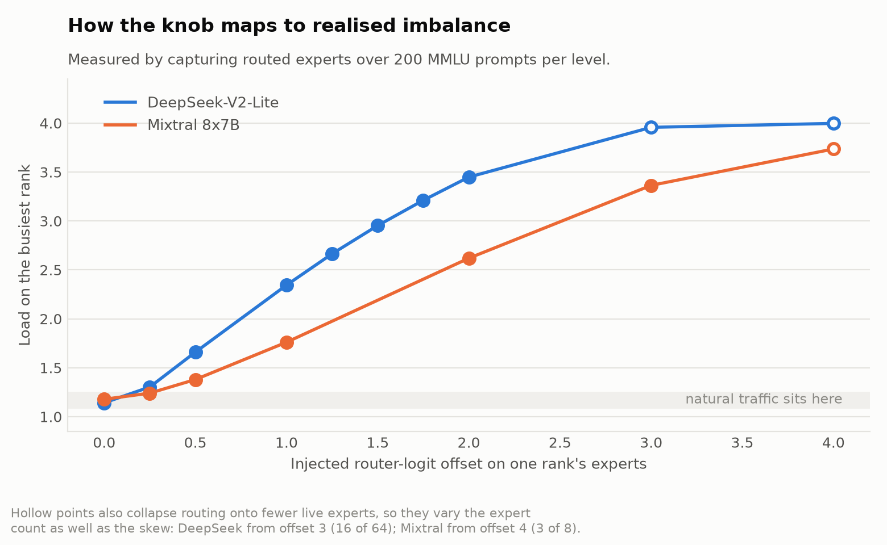

The knob is not the result — what matters is the imbalance it actually produces,
which has to be measured per model, because the two models' routers use different
score scales. Hollow points mark settings where routing also collapses onto fewer
experts; those are excluded from everything that follows.

### The result

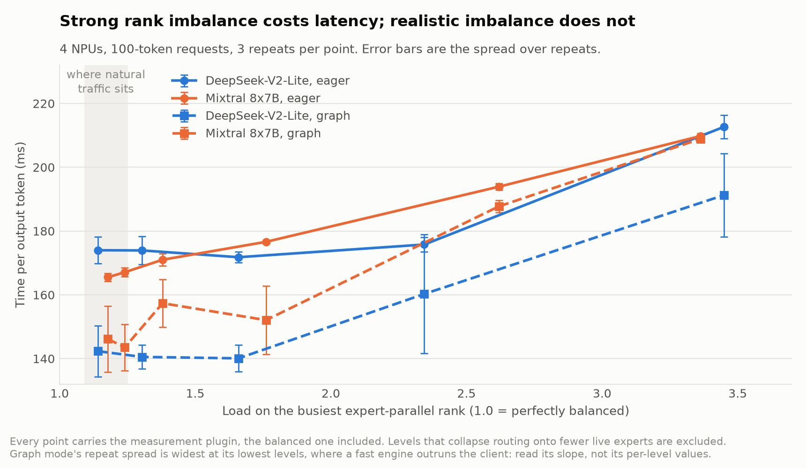

**Mixtral:** a clean, straight-line cost — TPOT rises about 12% for each
additional 1x of load on the busiest chip, from 165.5 ms balanced to 209.8 ms at
3.36x. This is the most statistically solid result in the project.

**DeepSeek:** the cost is large and real by 3.2–3.5x load, but its *shape* below
that is unresolved. Two sweeps disagree — one reads the cost as flat until 2.34x,
the other already sees +6.5% there — by more than either one's own repeat
spread. We do not currently know whether DeepSeek has a threshold or a gradual
slope.

**Correction, 2026-10-14/15: DeepSeek's cost was not a cost of skew.** At strong
bias the knob degrades DeepSeek enough that some answers end early (84 of 100
tokens on average, 205 of 300), and every DeepSeek point that cost heavily is one
of those. With every request forced to generate the same number of tokens, the
skew costs nothing: **−2.13% ±3.91** at 3.53x and 100 tokens, **−0.27% ±1.84** at
3.64x and 300, where natural length read +21% and +31% in the same rounds and
settings.

It is not the *number* of tokens either. Holding every request at 84 - the
shortened average - costs nothing at the same skew, while letting the model stop
where it likes costs **+17.7%** more (four of four rounds). At natural length 28%
of requests stop early at scattered points, and the whole server slows: requests
that still ran the full 100 tokens were as slow as the rest. Replaying exactly
those endings on a balanced server, with no skew at all, costs the same:
**+19.6%** against every request held at the same mean length, in six of six
rounds. Why scattered endings cost that much is not established.

So on DeepSeek the knob measured a side effect of itself. Natural imbalance does
not change what the model writes. Mixtral's answers never changed length, so its
straight-line cost stands and is the only demonstrated cost of skew here.

Both hold in **graph mode**, which is how a production deployment would run. (One
caveat: graph-mode repeat spread is widest at the *low* imbalance levels, which
fits the engine outrunning the client that feeds it rather than any property of
imbalance. Read the slope, not the individual points.)

---

## 4. The key picture: where real traffic actually sits

A cost that appears at 1.4x imbalance only matters if real traffic reaches 1.4x.
So we measured what unbiased traffic actually produces, using the same statistic,
from recorded routing of thousands of real prompts.

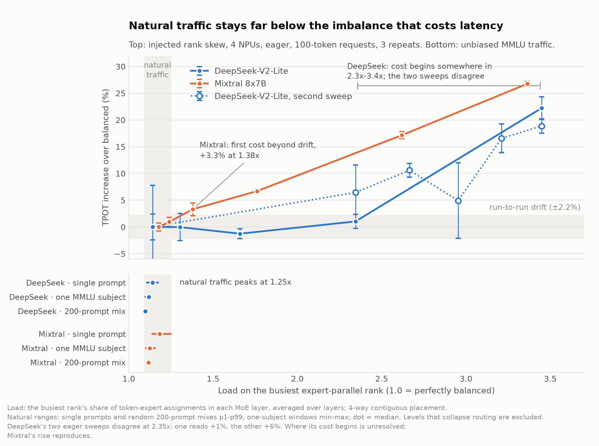

**Natural traffic peaks at 1.25x**, and that is the worst case — the 99th
percentile of *single prompts*, which is the most concentrated window real
traffic offers. Windows of one topic reach 1.10–1.16x. Mixed traffic sits at
1.10–1.12x.

**The first cost that exceeds run-to-run noise is +3.3% at 1.38x** (Mixtral).

So there is a clear gap between what traffic produces and what costs anything.
That gap is the whole result: **imbalance is not a problem you have, it is a
problem you could have if something changed** — a router fault, an unusual
workload, or wider expert parallelism.

> Wider parallelism is the one lever that has moved the straggler: 1.04x at 2
> chips, 1.13x at 4, 1.31x at 8, extrapolating to ~1.6x at 16. That is the
> direction in which this null might stop holding.

---

## 4b. Batch size decides whether ordinary imbalance costs anything

Everything above measures a *fixed* skew. A separate question is whether the
operating point changes the answer — and it does, more than anything else we
varied.

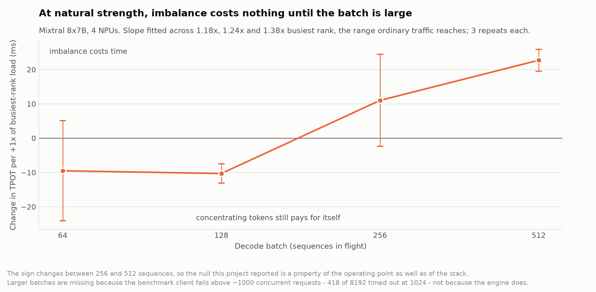

Holding the imbalance at the level ordinary traffic reaches (1.18x to 1.38x) and
varying only how many requests are in flight:

| Sequences in flight | Change in TPOT per +1x of load |
|---|---|
| 64 | −9.5 ± 14.6 ms |
| **128** | **−10.3 ± 2.8 ms** |
| 256 | +11.0 ± 13.4 ms |
| **512** | **+22.7 ± 3.2 ms** |

**The sign flips.** At 128 sequences more imbalance makes serving slightly
*faster* — the cancellation from section 2 still winning. At 512 it makes it
slower. So the headline null is a property of the operating point as well as of
the stack: a small-batch deployment can ignore imbalance that a large-batch one
cannot.

With a *strong* skew (2.62x) the same pattern appears as a growing penalty
rather than a sign change: +8.1% at 256 sequences against +14.8% at 512.

Two limits on this. Only the 128 and 512 points are individually resolved; 64
and 256 have error bars wider than their slopes. And larger batches are missing
because **our benchmark client fails above ~1000 concurrent requests** — 418 of
8192 timed out at 1024 — not because the engine does; KV memory would allow
about 4700. Going higher needs a different client, not a different config.

## 4c. Language concentrates routing, and it costs a little

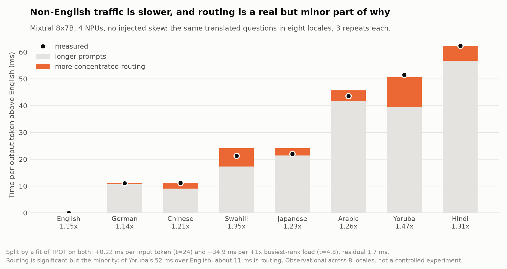

MMMLU is MMLU translated, so serving the same questions in eight locales varies
the language and nothing else. Routing concentration varies a lot with it —
Yoruba reaches 1.47x busiest rank where English sits at 1.15x — and so does
latency, from 159 ms to 221 ms.

Most of that is not routing. Low-resource languages tokenise into more tokens,
and a fit on both terms separates them: **+0.22 ms per input token** (t = 24) and
**+34.9 ms per +1x of busiest-rank load** (t = 4.8), with a 1.7 ms residual
across eight locales. Of Yoruba's 51 ms over English, about **39 ms is prompt
length and 11 ms is routing**.

So routing concentration is a real, significant and *minor* contributor. The
practical reading is that a multilingual deployment pays mostly for tokenisation,
and a little for the imbalance that language-specialised experts create. This is
observational across eight locales with the two predictors correlated +0.62, not
a controlled experiment.

## 5. It matters *which* chip is hot, and the models disagree

Every experiment so far made one chip hot in *every* layer. Real imbalance does
not look like that — we measured that in natural traffic, the busiest chip leads
only **34–35%** of layers, close to the 25% you would get by chance.

So we built the matched comparison: bias a *different* chip in each layer. Each
layer is skewed exactly as hard as before, but no chip is hot throughout.

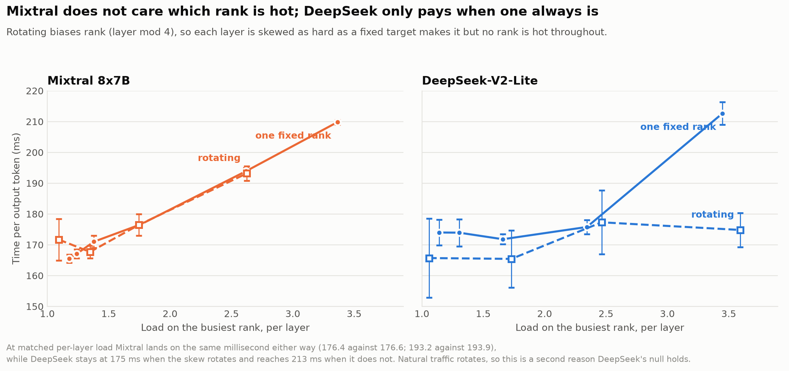

**Mixtral does not care.** At matched imbalance the two land on the same
millisecond — 176.4 against 176.6 ms, and 193.2 against 193.9 ms. Its cost is a
property of each layer, not of which chip carries it.

**DeepSeek only pays when one chip is persistently hot.** A rotating skew is flat
across the entire range, where a fixed one costs +22% at the same imbalance.

This fits where each model's cost was already traced to: DeepSeek's lives in
partially-filled generation steps, where one chip being late at every layer
accumulates down the stack; Mixtral's lives in prompt-reading steps, where each
layer's own computation is on the critical path regardless of which chip it is.

**Consequence for the null:** natural traffic rotates. So DeepSeek's imbalance is
free for *two* reasons — it is small, and it is the kind that costs nothing even
when large. Mixtral's safety rests on smallness alone.

**Withdrawn for DeepSeek, 2026-10-15.** The fixed arm's +22% point is one where
DeepSeek's answers ended early (84 of 100 tokens); the rotating arm kept its
length (99.3). With length held, a *fixed* 3.53x skew costs DeepSeek nothing too
(section 3), so both shapes are free and there is no contrast. Natural traffic's
rotation is no longer a second reason DeepSeek's imbalance is free: the first
reason - it costs nothing at any skew we can measure - is enough. Mixtral's half is
unaffected.

---

## 6. The measurement trap that runs through everything

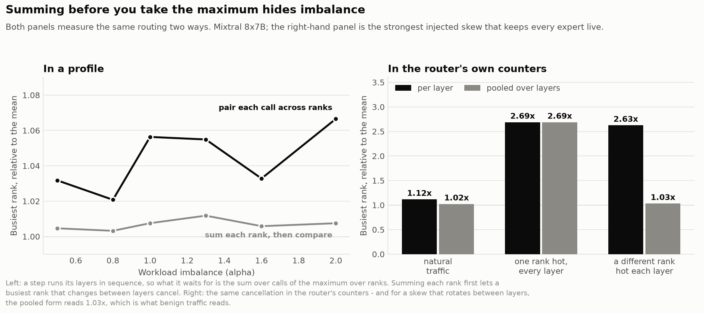

The same mistake appears in three separate places, and it is the most
transferable thing we learned.

**To measure imbalance you must take the maximum before you sum, not after.**

A generation step runs its layers one after another. What it waits for is
therefore *the sum over layers of the worst chip in each layer*. If instead you
total each chip's work across all layers and then compare chips, a busiest chip
that changes from layer to layer cancels out.

The numbers are stark:

- **In profiles:** pairing each computation across chips gives a straggler of
  1.067x. Summing each chip first gives 1.004x — "perfectly balanced".
- **In routing counters:** natural traffic reads 1.12x per layer and 1.02x
  pooled.
- **Worst case:** a skew that rotates between layers reads **2.63x per layer and
  1.03x pooled** — the pooled form reports a genuinely strong, latency-costing
  imbalance as a balanced server.

**This matters beyond our project.** vLLM's own EPLB "balancedness" metric
computes the pooled form. In version 0.23, the one on our machine, a chip that is
hot in *every* layer reads as **1.00 — perfectly balanced**, which is exactly the
case that costs latency. Upstream has since fixed that reduction, but any
monitoring built on the shipped statistic is blind to the condition it should
catch.

---

## 7. Detecting the imbalance that matters

Given all the above, what would a practical monitor look like? We designed and
evaluated a three-stage pipeline.

| Stage | Reads | Runs | Answers | State |
|---|---|---|---|---|
| **1. Screen** | token-to-expert counts per layer and chip | always | is imbalance high? | works |
| **2. Confirm** | engine step times, by step type | on alarm | is it costing time? | works, but only from profiler traces |
| **3. Attribute** | a short profiled window | rarely | which chip, and why? | does not work yet |

**Everything here was computed offline.** The server records which experts each
token was routed to, and a run writes profiler traces; the windowing, sampling,
thresholds, alarms and step fits are all applied to those recordings afterwards.
The routing and the step times are real, so what each stage would *read* is
faithful — but nothing runs inside the serving loop, and no runtime cost has been
measured. Stage 1 has a cheap online implementation sketched (a counter in the
expert-selection path) and not built. Stage 2 would not need the profiler in
production, since the engine already knows how long each step took and what was
in it, but that version does not exist either.

**And no stage infers impact from routing.** It cannot: a rotating skew gives
Mixtral and DeepSeek identical routing statistics and opposite costs, and
DeepSeek's own curve is flat to 2.34x and then jumps. The screen's threshold is
*calibrated* from a separately measured cost curve — per model, and as section 2
shows, per batch size too. Stage 2 is the only part that measures impact, and it
reads step times rather than routing. An alarm means "look here", never "this is
costing you".

Stage 1's threshold comes from the measured **cost** curve, not from the load
distribution — because, as section 5 showed, the same load costs full price on
one model and nothing on the other.

### It works, and it is cheap

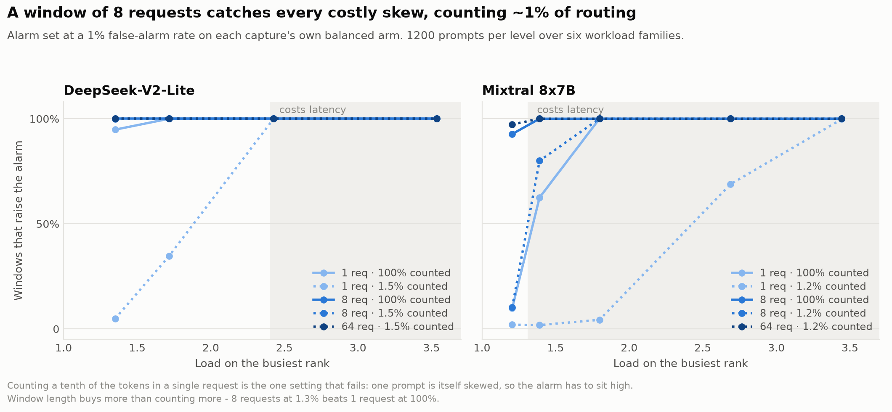

Counting just **1.2–1.5%** of token-to-expert assignments (4 layers out of 26–32,
a tenth of their tokens) over a window of **8 requests** flags *every* imbalance
level that costs latency, on both models, at a 1% false-alarm rate.

**And "cheap" is now measured, not assumed.** Counting that way inside the server
costs **+0.28% ±0.71** of end-to-end latency on Mixtral, against a baseline that
itself varies by 0.44% — too small to measure. Collecting the full routing
instead, the way the calibration runs do, costs **+6.38%** on the same traffic.
The screen is a cheaper mechanism, not a fraction of the expensive one: it keeps
the counting on the device, copies out once per window, and counts on one rank
instead of returning per-request data from four.

**Window length matters far more than how much you count.** One request at 100%
counted performs *worse* than 8 requests at 1.3%. A single prompt is itself
skewed, so its benign spread is wide and the alarm has to sit high — the screen
then goes blind to exactly the levels that matter.

**On DeepSeek the cost is still unmeasured, and now we know it is blindness.**
The +0.28% above is Mixtral's. DeepSeek's serving noise at this concurrency is
large enough to hide anything of that size, and the way to tell a null from a
blind instrument is a positive control. Run `gate-closure` on 2026-10-13 put all
four things in one set of shuffled rounds on DeepSeek — nothing collected, the
screen, full capture, and EPLB — at two free skew levels, 5 repeats, 40 of 40
points completed. (Every point ran beside another user's jobs on NPUs 4-5,
equally in every arm; this was first recorded as "no contention", which was
wrong.) Median paired difference against the
`base` arm, in end-to-end latency:

| | 1.09x | 1.73x |
|---|---|---|
| screen | +1.65% | +1.71% |
| **capture (the control)** | **+6.38%** | **+9.51%** |
| EPLB | +0.71% | +1.52% |
| baseline's own spread | 3.41% | 2.39% |

**The control fires.** Capture is the largest effect at both levels, +9.8% and
+17.5% of makespan, and at 1.73x its interval excludes zero. So this regime can
see an effect of roughly that size, and the screen's +1.7% is a real bound rather
than an instrument reading nothing.

What it does not do is close the argument it was built to close. The screen's
reading sits under the baseline's own spread, so it is bounded, not measured. And
the quantity it was supposed to be cheaper than moved: **EPLB's +4.73% at 1.73x
did not replicate**, coming back at +1.52% median (+2.33% mean, interval −0.8% to
+5.5%) on five fresh pairs. That run measured end-to-end latency with
streaming off, though, and the original was TPOT with streaming on: re-measured in
TPOT by `eplb-gated` it came back at +5.52%, and pooled with eplb-fp2 it excludes
zero (+5.12%, +1.7% to +8.5%; see the live-gate section above). So in this run both
quantities are small and neither is separable from zero at this replication:
the screen is probably cheaper than the false positive it averts, and the gap is
not measurable. The screen is pinned down on Mixtral (+0.28% ±0.71); the cost
of rearranging for nothing is now pinned down in DeepSeek's TPOT and remains
unresolved on Mixtral (+1.85% ±1.88 at 1.76x). But the live gate showed that
the screen-against-false-positive sum was the wrong one to close: with the gate
shut, EPLB still costs +3.23% at 1.73x, so most of the false positive is not
the rearranging a gate can avert.

### One alarming window is not an alarm

A 1% false-alarm rate per window sounds small. It is not: it means a false alarm
every few hundred requests. Requiring **two consecutive** alarming windows fixes
it — detection 98–100%, early firing 0–1%, one false alarm per 1200–1750
requests — at a cost of 16 requests of delay.

### Adjusting cost against accuracy

The counting is not the expensive part. What costs is what the screen *triggers*:
a profiled confirmation measured at **+15–19% TPOT while it runs**.

| Window | Consecutive windows | Detection | Delay | Amortised cost |
|---|---|---|---|---|
| 8 | 1 | 0.50–0.76 | 8 reqs | **3.1–6.1%** |
| 8 | 2 | 0.98–1.00 | 16 reqs | 1.3–1.8% |
| **8** | **3** | **1.00** | **24–40 reqs** | **0.2%** |

**Requiring three consecutive windows improves accuracy and cost at the same
time**, for a few dozen requests of delay. Cutting the sampling further would be
the wrong economy — it is already the small term.

### Sample the layers at random, not on a fixed schedule

Counting the same few layers every window has a blind spot, and it is worse than
a missing feature. On 26 MoE layers, four evenly spaced picks land on 0, 8, 17
and 25 — and a skew confined to layers 9 to 14 falls entirely between them.
Measured: the screen detects that skew in **1% of windows**. It is not that it
cannot say where the problem is; it cannot see it at all.

Redrawing the four layers each window costs exactly the same and detects it in
**66%**, the chance that a random four of 26 includes one of the six affected. On
a skew that touches every layer — the case all the other numbers here use —
random sampling is indistinguishable from fixed (0.68 against 0.72 at Mixtral's
hardest level). It is strictly better, and it is the configuration to use.

### It can say *where*, not just *whether*

Because the counts are per layer, the screen can report which layers are affected
and whether one chip carries them. With a skew confined to 6 of 26 layers on
chip 2 — where the model-wide average reads a near-benign 1.40x — per-layer
flagging recovered **exactly those 6 layers, named chip 2, and flagged nothing in
the balanced case.**

With random layer sampling this needs no second mode and no extra counting: each
layer accumulates its own evidence over successive windows, and after 50 windows
— 400 requests, still at about 1% of routing counted — every layer has been seen
and the six affected ones come back with precision and recall 1.0. An earlier
version of this result pooled every layer, every token and 800 requests at once,
which is not something the screen could do at all.

That distinction is directly actionable: a skew that one chip carries throughout
might be fixed by moving experts; one that rotates between layers cannot be, and
there is no point trying.

---

## 8. Detecting router faults (a separate question)

A related question: can you tell from expert load alone that the *router itself*
has changed, as opposed to the traffic changing?

**For gross faults, yes.** A router collapsing onto 6 of 64 experts scores 37x
above the benign ceiling — perfect separation.

**For subtle faults, no.** A router that misroutes less than roughly 10–20% of
its decisions is hidden by ordinary variation in what users ask about. The
limiting noise is the *workload*, not statistics: normal topic variation produces
7x more apparent drift than sampling error.

The fix is to stop comparing different traffic. Replaying a fixed set of
**canary** prompts compares routing on identical inputs, which removes the
confound by construction rather than statistically. Recorded data suggests this
lowers the noise floor by about 80x. One caveat found along the way: identical
prompts do not route identically — about 2% of decisions flip — so the floor is
not zero, and generated-token routing diverges enough that it must be excluded.

---

## 9. How we got things wrong

Several results looked real and were not. These cost the most time and are the
most reusable.

**A measuring instrument that was missing from the control.** Our router-bias
plugin runs on every chip at every imbalance level — except zero, where it wasn't
installed at all. So every comparison against "balanced" included the
instrument's own cost. It was 10.0 ms per token on DeepSeek and nothing on
Mixtral, and it inflated DeepSeek's measured cost by 43%.

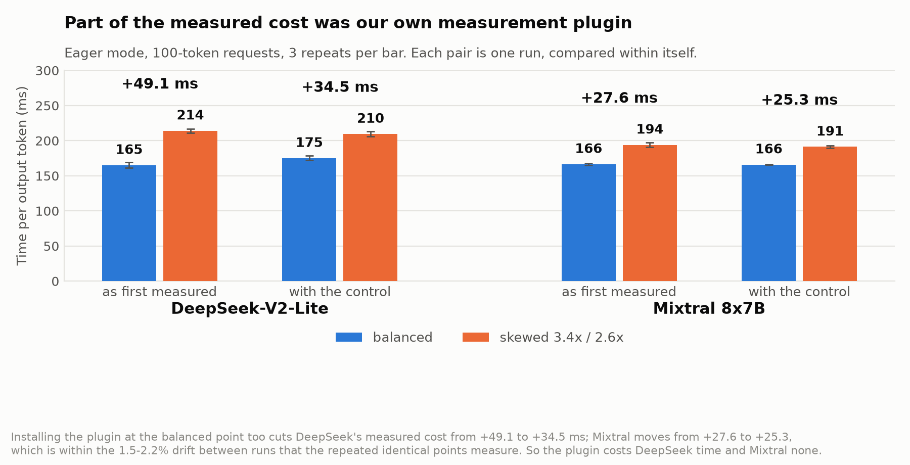

Worse, it could not be corrected afterwards: the plugin was present at exactly
the non-zero levels, so its cost is mathematically indistinguishable from a real
jump at the first non-zero level. The affected runs had to be repeated.

**Three apparent effects dissolved under repetition.** Single elevated readings
looked like thresholds and turned out to be the machine. Repeating each
measurement is the only noise floor available.

**And that floor is not the same for both models.** The balanced arm of the same
sweep, repeated three times, spreads ±2.4% on DeepSeek and ±0.8% on Mixtral. The
±2.2% drift band used as the threshold throughout is therefore about right for
Mixtral and slightly optimistic for DeepSeek - which is consistent with DeepSeek
being the model whose curve shape we could not resolve. A single shared noise
floor quoted for both models would misreport one of them.

**Statistical significance from the wrong unit.** Comparing thousands of
individual requests gave p-values below 1e-90 for differences that repetition
showed to be noise. All requests in one measurement share a server, a warm-up and
a scheduling pattern — the unit of replication is the run, so n = 1 per point,
not 1000.

**A hidden confound between imbalance and batch size.** Building workloads to a
fixed token budget meant more imbalanced workloads automatically used more,
shorter prompts. Imbalance and request count were 98% correlated, and the
resulting "effect" vanished at a fixed request count.

**Averaging over a profiling window compares different workloads.** The mix of
step types shifts with the parameter being swept, so window averages disagreed
with end-to-end latency by 1.5–3x. Steps must be matched by type and size before
comparing.

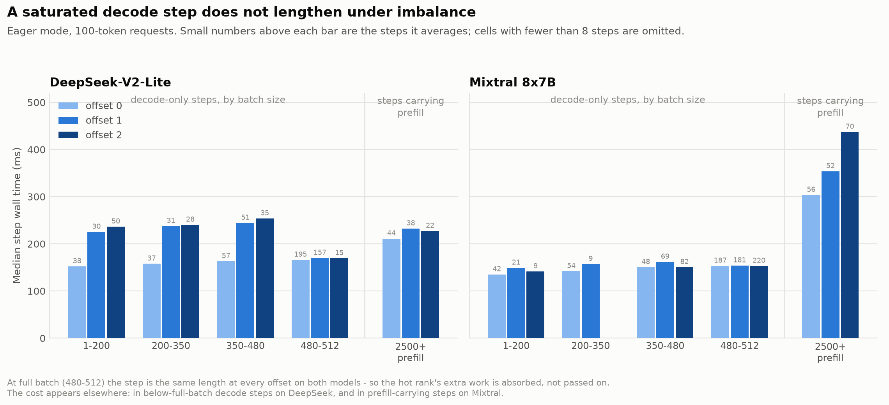

**Another user's job on the same machine** costs about 3% TPOT and 31% prompt
latency even on chips our run was not using. Every measurement now records
whether anyone else was present.

---

## 10. What we would tell someone deploying this

1. **Expert imbalance is not currently costing you anything** on this stack, at
   up to 8-way expert parallelism, for normal traffic.
2. **EPLB gains nothing here, and costs a little.** Re-measured with placements
   actually applied: it removes a 3.64x skew and recovers nothing, because once
   output length is held that skew costs nothing to begin with; rearranging for
   no reason costs +3.8% to +5.1%. Gate it on a
   screen rather than leaving it on — the screen costs under 1% to run, so the
   gate pays for itself.
3. **If you monitor imbalance, use the per-layer statistic.** The pooled form —
   including the one vLLM's EPLB logs in 0.23 — reports the worst realistic case
   as perfectly balanced.
4. **A cheap monitor is enough, and it really is cheap.** ~1% of routing counted,
   over 8 requests, with three consecutive alarms required, measured at under 1%
   of latency — provided the counting stays on the device. Returning the routing
   to a client instead costs six times more than the screen is worth.
5. **Treat an alarm as "look here", never as "this is costing you."** The same
   imbalance costs full price on one model and nothing on another.
6. **Watch expert-parallel width.** It is the one lever that has raised the
   straggler, and it is heading towards the band that costs latency.

---

## 11. What is still open

**Mechanism.** We know *that* strong skew costs latency and we know *where* in a
step it appears, but not *why*. Two explanations have already been proposed and
retracted on further measurement.

**Why scattered early stops slow the whole server.** DeepSeek does not pay for
skew at either length tested once answer length is held; what cost ~20% was a
spread of requests ending early, which the router-bias knob causes as a side
effect. That spread alone, replayed with no skew, reproduces the cost (+19.6%
against uniform lengths at the same mean). A step profile against uniform lengths
is the next measurement. It matters beyond this project: real traffic always has
a spread of answer lengths, so every uniform-length benchmark here is optimistic.

**The monitor's own cost on the device.** We can price the whole pipeline from one
number — the cost of incrementing a counter per routing decision — and that number
has not been measured on hardware.

**Imbalance that ramps or flickers.** Every measurement uses a server whose
imbalance is fixed for its lifetime. Detection delay has only been measured for an
instantaneous onset into a standing skew.

**Wider expert parallelism**, which is the most likely way the null breaks.

**How far the regime moves the cost, and therefore the threshold.** We have two
points on that axis — 100 and 300 generated tokens, a factor of five in the cost
of the same Mixtral skew — and no curve between or beyond them. A deployment
cannot calibrate against a quantity whose dependence on its own traffic is
unmapped, and every EPLB measurement in the project sits at 300 tokens, so
whether a balancer pays in a prefill-heavy deployment is untested.

**What EPLB does for a *rotating* hot rank.** Every EPLB run here injects a fixed
expert target, which is the case a placement change can fix. Natural traffic
rotates, and a balancer chasing a hot rank that has already moved is the failure
mode this project's own rotating-skew result predicts and nobody has measured.

**Where EPLB's standing cost comes from.** With the gate shut and nothing moved,
EPLB still cost +3.23% TPOT at 1.73x on DeepSeek. Heat collection, the load
all-gather, the planner subprocess and the empty loader cycle are the candidates,
and on a host-bound eager server a CPU-side cause is the first suspect. An arm
with EPLB enabled and its intervals set beyond the batch length would separate
collection from planning; the reading also needs a second level that is not
drowned by the off arm's own spread, as 1.09x was.

**Stage 2's discriminating power.** The rotating-skew result gives the sharpest
possible test — two cases with identical imbalance where one costs full price and
the other nothing — and the measurement is running now.

---

## Appendix: reproducing the figures

`scripts/plot_findings.py` regenerates every figure in this document from the run
records under `results/`, and writes `figures/figures.json` with every plotted
number. It also writes `figures/bare/` - the same figures with the titles,
captions and callouts removed, for slides where the speaker does the explaining.
Series identity and numeric value labels stay, since without them a mark cannot
be read. `scripts/detection_eval.py` regenerates the detection analysis into
`detection.json`. Neither hard-codes a result; both name the runs they read.

Two routed-expert captures are needed for the traffic figures and are excluded
from the default sync because of their size — see [usage.md](usage.md).
